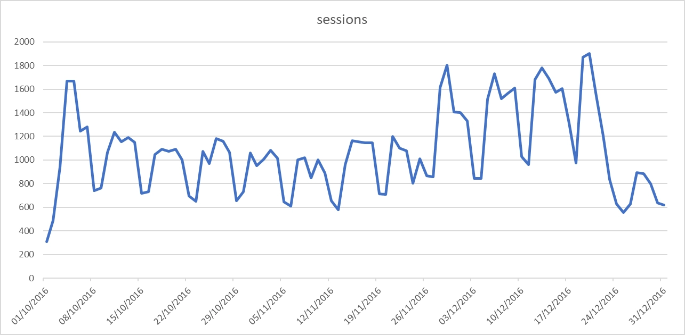
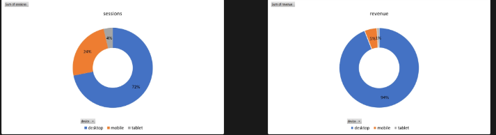

# Digital Marketing Strategy Optimisation (SQL)

SQL analysis of Google's public **Google Merchandise Store** e-commerce dataset (US users, Oct 1 – Dec 31, 2016, ~99K sessions, ~70K visitors) in **MySQL**, focused on traffic, conversion, revenue, retention, and channel performance.

📄 **Full write-up with every query and output:** [Portfolio project page](https://www.datascienceportfol.io/markojanev12/projects/1)

## Business questions
- How do users engage with the site across days of the week?
- Which devices and regions drive sessions vs. revenue?
- How many visitors come back?
- Which traffic channels bring the most engaged and highest-converting visitors?

## What I did
- **Combined** three monthly tables (Oct, Nov, Dec) into one dataset with `UNION ALL`
- **Validated the session key:** found that `visitid` is a session start timestamp, not a unique ID, and built `unique_session_id` = `fullvisitorid` + `visitid`; investigated the two remaining duplicates (sessions spanning midnight)
- **Analysed** traffic, conversion, and revenue by weekday, device, region, and channel using subqueries, `CASE` logic, and window functions (`SUM(...) OVER ()` for percent-of-total)
- **Corrected the retention query:** the first version grouped by the `newVisits` flag, which double-counted visitors who appeared as both new and returning (82,078 vs. 70,037 actual visitors). Rebuilt it by counting sessions per visitor.

## Key findings
| Area | Finding |
|---|---|
| Weekly pattern | Traffic peaks Tue–Wed; Monday has the highest conversion rate; weekends drop sharply |
| Device | Mobile = ~24% of sessions but only ~5% of revenue |
| Retention | **79.9%** of visitors (55,962 of 70,037) visited only once |
| Channels | Referral has the lowest bounce rate and best conversion (~6.6%); Organic Search drives the most sessions; Social and Affiliates convert worst |

## Recommendations
1. **Fix the mobile funnel** — mobile traffic is not converting into revenue; review mobile checkout and UX
2. **Invest in Referral partnerships** — the best-converting channel
3. **Time campaigns to the weekly pattern** — promotions early in the week, when conversion is highest
4. **Build retention** — with 80% one-time visitors, email capture and retargeting are the biggest untapped lever

## Files
| File | Description |
|---|---|
| `gms_analysis.sql` | All SQL queries, in the order of the analysis |
| `sessions_by_day.png` | Daily sessions chart |
| `device_split.png` | Sessions vs. revenue by device |

## Data source
Google Merchandise Store sample dataset, available publicly in [Google BigQuery](https://console.cloud.google.com/marketplace/product/obfuscated-ga360-data/obfuscated-ga360-data). Some fields are aggregated; revenue is stored ×10⁶ and divided back in the queries.

## Tools
MySQL · MySQL Workbench · Excel (charts)
